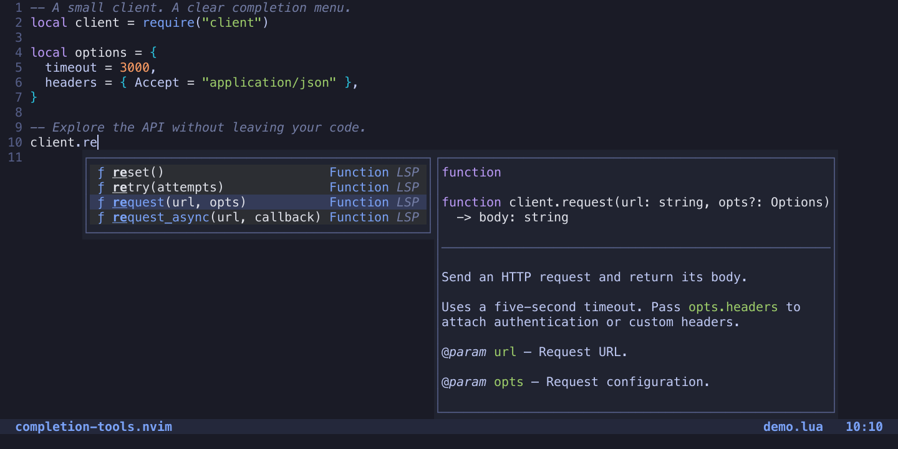
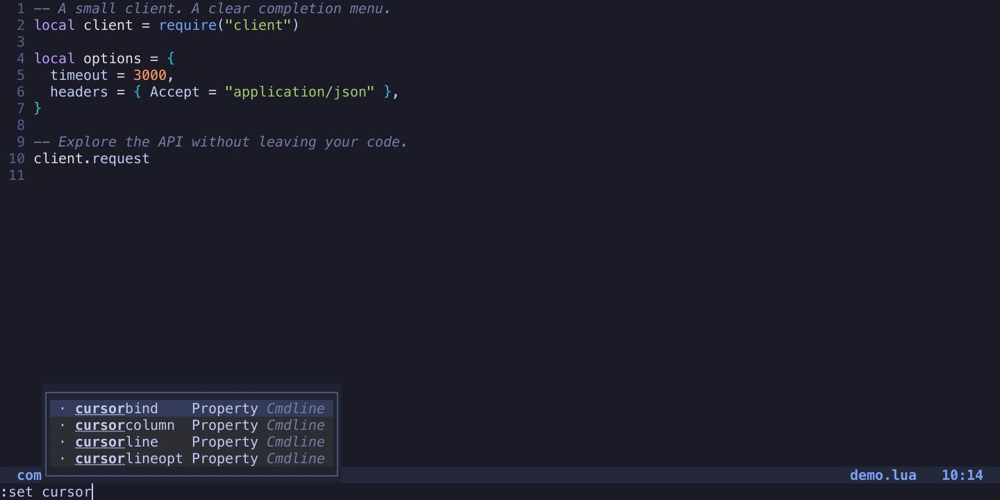

# completion-tools.nvim

**Completion that stays out of your way.** Pure Lua, built for Neovim 0.11+.
No build step or required third-party dependencies.



*Live Lua language-server completions in Neovim, with syntax-colored signatures and documentation. [Reproduce the screenshots](doc/screenshots/README.md).*

- **Ready to code:** LSP, async paths, buffer words and native snippets out of the box; optional LuaSnip and Copilot support.
- **Easy to read:** aligned columns, kind icons, highlighted matches and automatic documentation.
- **Smooth while typing:** incremental word indexes, cancellation and reusable completion lists; the previous menu stays visible while results arrive.
- **Beyond code:** opt-in command/search completion, custom dictionaries, native spelling suggestions and local WordNet definitions.
- **Yours to extend:** custom providers, context-aware sources, keymap action chains and theme highlights.

## Install

With [lazy.nvim](https://github.com/folke/lazy.nvim):

```lua
{
  "Jacky-Lzx/completion-tools.nvim",
  main = "completion-tools",
  event = { "InsertEnter", "CmdlineEnter" },
  opts = {
    cmdline = { enabled = true }, -- Optional command and search completion
  },
}
```

Or add the plugin to your runtime path and call `require("completion-tools").setup()`.
Disable other completion engines to avoid competing menus and mappings.
Default kind icons need a Nerd Font; use `menu = { kind_icons = false }` to hide them.

### Connect your language servers

Merge capabilities **before starting servers**. With Neovim's native LSP configuration:

```lua
vim.lsp.config("*", {
  capabilities = require("completion-tools").get_lsp_capabilities(),
})
-- Configure and enable your language servers as usual.
```

When lazy-loading, make your LSP configuration depend on this plugin so the module
is available during server setup. `get_lsp_capabilities(base)` preserves other capabilities.

### Copilot completions

Install and configure [copilot.lua](https://github.com/zbirenbaum/copilot.lua), then
add `"copilot"` to `sources`:

```lua
require("copilot").setup({ suggestion = { enabled = false }, panel = { enabled = false } })
require("completion-tools").setup({
  sources = { "copilot", "lsp", "path", "buffer", "snippets" },
})
```

Authenticate with `:Copilot auth`. Suggestions appear in the normal menu and use
the same accept keys, including multiline edits. See the
[Copilot configuration](doc/configuration.md#copilot) for lazy loading and debounce.
Up to three unique suggestions appear in purple; the service may return fewer.

## Everyday keys

| Key | Action |
| --- | --- |
| `Ctrl-Space` | Open completion; show documentation if already open |
| `Ctrl-N` / `Ctrl-P` | Select next / previous |
| `Ctrl-Y` | Accept selection |
| `Tab` | Accept, jump to the next snippet placeholder, or fall back |
| `Shift-Tab` | Jump to the previous placeholder, or fall back |
| `Ctrl-E` | Close the menu, or fall back |
| `Enter` | Keep your existing behavior |

The first item is preselected. Navigating never inserts text. Automatic completion
starts when you edit text; entering Insert mode alone does not open a menu.

With command-line completion enabled, `Tab` accepts without executing,
`Up` / `Down` select, and `Enter` keeps its native command/search behavior.



*Command-line completion uses Neovim's native candidates and preserves their order.*

## Make it yours

```lua
require("completion-tools").setup({
  sources = { "lsp", "path", "buffer", "snippets" },
  snippets = { preset = "luasnip" }, -- Optional; requires your LuaSnip setup
  menu = { border = "rounded", max_height = 10 },
  documentation = { delay_ms = 150 },
  cmdline = { enabled = true },
})
```

Keep the default snippet preset to use `vim.snippet` and your own snippet collection.
See the [configuration guide](doc/configuration.md) for dictionaries, spelling,
keymaps, menu styling, custom sources and external command-line UI integration.

## Learn more

- [Configuration and examples](doc/configuration.md)
- [API and in-editor help](doc/completion-tools.txt) — `:help completion-tools`
- [Performance measurements and reproduction](doc/performance.md)
- [Tests and development](doc/configuration.md#development)

Run `:checkhealth completion-tools` to check your setup.

[MIT License](LICENSE)
