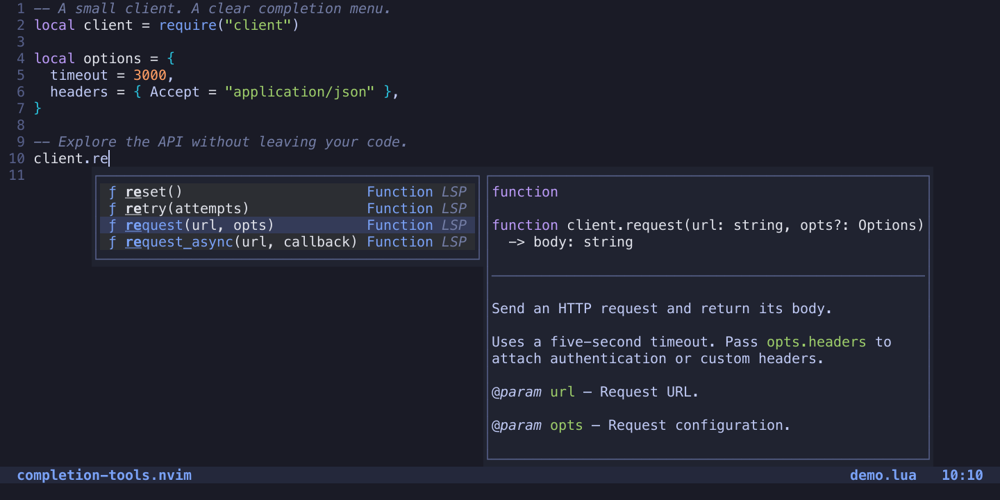
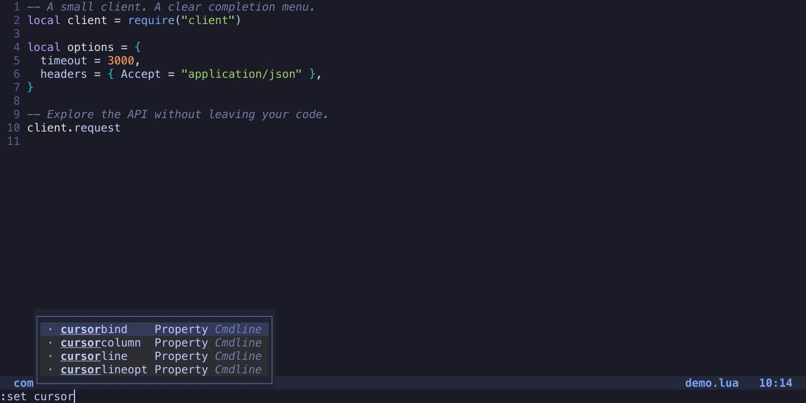

# Screenshots

[Quick start](../README.md) · [Reproduce the screenshots](screenshots/README.md)

Existing captures from real Neovim sessions. See the linked reproduction tools
where supplied by the original workflow documentation.

Lua completion with highlighted signatures and documentation

Native Ex option completion in Neovim
